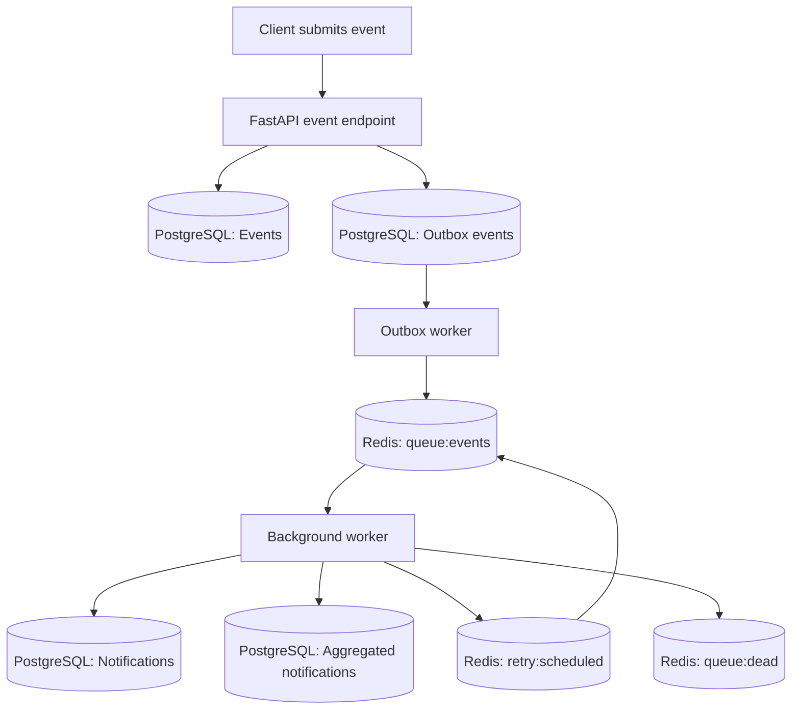

# Notification Aggregator

A backend application for receiving events, persisting them in PostgreSQL, processing them asynchronously through Redis, and generating individual and aggregated notifications.

The project demonstrates practical backend engineering concepts including the **outbox pattern, producer–consumer processing, Redis queue recovery, retry scheduling, dead-letter handling, database idempotency safeguards, and concurrency control**.

## Table of Contents

- [Problem Statement](#problem-statement)
- [Key Features](#key-features)
- [Technology Stack](#technology-stack)
- [System Architecture](#system-architecture)
- [Event Processing Workflow](#event-processing-workflow)
- [API Routes and Endpoints](#api-routes-and-endpoints)
- [Failure Handling and Reliability](#failure-handling-and-reliability)
- [Database Design](#database-design)
- [Important Engineering Decisions](#important-engineering-decisions)
- [Testing](#testing)
- [Limitations and Future Improvements](#limitations-and-future-improvements)
- [What This Project Demonstrates](#what-this-project-demonstrates)

## Problem Statement

Processing every event completely inside an API request can make request handling slower and makes recovery harder when a dependent service is temporarily unavailable.

Notification Aggregator separates event acceptance from background processing. It first stores an event and its delivery record in PostgreSQL, then uses an outbox worker and Redis queue to pass the event to a background worker. The worker creates an individual notification and, when the event has a suitable entity ID, adds it to an aggregated notification group.

**Scope:** The current application accepts generic event payloads. Direct integrations that fetch notifications from Gmail, WhatsApp, or other external applications are not implemented in the reviewed code.

## Key Features

- **Transactional event persistence:** Stores the event and its outbox record in one PostgreSQL transaction.
- **Outbox-based delivery:** A separate worker retries delivery of pending outbox records to Redis.
- **Asynchronous event processing:** Uses Redis lists to decouple event ingestion from notification processing.
- **Atomic queue transfer:** Uses Redis `BLMOVE` to transfer events from the main queue to the processing queue.
- **Processing recovery:** Moves entries left in the processing queue back to the main queue when the worker starts.
- **Retry scheduling:** Uses exponential backoff with a Redis sorted set to schedule retries.
- **Dead-letter handling:** Sends malformed payloads and events that exceed the retry allowance to a dead-letter queue.
- **Individual notifications:** Creates a notification for an event, with a unique constraint on `event_id` to help avoid duplicate notification rows.
- **Notification aggregation:** Groups eligible unread events by user, event type, and entity ID.
- **Concurrency control:** Uses PostgreSQL advisory locks and row locks while updating aggregation groups.
- **Structured logging:** Records processing activity, retries, delivery failures, and other operational events.

## Technology Stack

| Technology | Role |
|---|---|
| Python | Application and worker implementation |
| FastAPI | HTTP API |
| Pydantic | Incoming event validation |
| PostgreSQL | Durable event, outbox, and notification storage |
| SQLAlchemy Async ORM | Asynchronous database access and transactions |
| Redis | Event queues, processing list, retry schedule, and dead-letter queue |
| Redis Lua scripts | Atomic multi-command Redis transitions |
| Pytest / pytest-asyncio | Asynchronous worker tests |

## System Architecture



**Component responsibilities**

- **FastAPI:** Validates the incoming event and persists the event plus outbox record.
- **PostgreSQL:** Stores the durable application records and their processing/delivery status.
- **Outbox worker:** Attempts to deliver pending outbox payloads to Redis.
- **Redis:** Holds queued, processing, retry-scheduled, and dead-letter events.
- **Background worker:** Creates individual notifications, updates event status, and maintains aggregation groups.

## Event Processing Workflow

1. **Receive an event.** The `POST /events` endpoint validates the JSON request using the `EventRequest` Pydantic model.
2. **Persist the event.** The endpoint inserts a record into `Events` and a corresponding record into `outbox_events` within the same PostgreSQL transaction.
3. **Deliver from the outbox.** The outbox worker selects pending records in batches of up to 20. It uses `FOR UPDATE SKIP LOCKED` to help concurrent outbox workers claim different records.
4. **Enqueue in Redis.** The outbox worker pushes the event payload to `queue:events`. When enqueueing succeeds, it marks the outbox record as delivered.
5. **Move to processing.** The background worker uses `BLMOVE` to move an event from `queue:events` to `queue:processing`.
6. **Create the individual notification.** Inside a PostgreSQL transaction, the worker attempts to insert a notification and updates the original event's status to `processed`.
7. **Aggregate when eligible.** If the individual notification is newly inserted and the event has an entity ID, the worker updates a matching unread aggregation or creates a new group.
8. **Acknowledge or recover.** After successful processing, the worker removes the event from the processing list. Failed events are scheduled for retry or moved to the dead-letter queue. Entries left in the processing list can be recovered when the worker starts.

## API Routes and Endpoints

### `GET /health`

Checks whether the API process is responding.

**Success response — `200 OK`**

```json
{
  "status": "healthy"
}
```

> This is a basic API health check. It does not independently confirm that PostgreSQL and Redis are reachable.

### `POST /events`

Accepts an event, validates the JSON request using the `EventRequest` model, and stores the event and its outbox record in PostgreSQL. The event is processed asynchronously by a background worker.

**Example request**

```json
{
  "event_id": "evt_101",
  "event_type": "COMMENT_CREATED",
  "user_id": 101,
  "source": "document_service",
  "entity_id": "doc_55",
  "payload": {
    "entity_id": "doc_55",
    "comment": "A new comment was added"
  }
}
```

**Success response — `202 Accepted`**

```json
{
  "notification_id": "generated-uuid",
  "status": "accepted"
}
```

The response field is named `notification_id` in the current code, but the UUID is generated when the event is accepted. It does **not** mean that the background worker has already created the individual notification.

**Request fields**

| Field | Type | Required | Description |
|---|---|---|---|
| `event_id` | String | Yes | Identifier for the logical event; must be unique in the events table. |
| `event_type` | String | Yes | Type of event, such as `COMMENT_CREATED`. |
| `user_id` | Integer | Yes | User associated with the event. |
| `source` | String | Yes | System or service that produced the event. |
| `entity_id` | String or null | No | Related entity; used to build the aggregation key. |
| `payload` | Object or null | No | Additional event data. |

**Error responses**

| HTTP status | Meaning |
|---|---|
| `409 Conflict` | The `event_id` already exists in the events table. |
| `500 Internal Server Error` | An unhandled event-persistence error occurs. |
| `422 Unprocessable Entity` | The request does not satisfy FastAPI/Pydantic validation. |

---

## Failure Handling and Reliability

### 1. Outbox delivery

The event and its outbox record are committed together in PostgreSQL. If Redis enqueueing fails, the outbox worker leaves the record pending so it can be attempted again.

This preserves the delivery intent, but it does not guarantee exactly-once delivery. If Redis accepts a payload and the outbox worker fails before the PostgreSQL transaction commits, the payload may be enqueued again.

### 2. Redis queues

| Redis key | Purpose |
|---|---|
| `queue:events` | Events waiting to be processed. |
| `queue:processing` | Events currently being processed or awaiting acknowledgement. |
| `retry:scheduled` | Sorted set containing failed events and their next retry timestamps. |
| `queue:dead` | Dead-letter list for malformed or repeatedly failing events. |

### 3. Atomic queue movement and recovery

- **`BLMOVE`:** Moves an event from `queue:events` to `queue:processing` in one Redis operation.
- **`LMOVE`:** During worker startup, moves leftover entries from `queue:processing` back to `queue:events`.
- **Processing acknowledgement:** After processing, the worker removes the event from `queue:processing`.

These mechanisms reduce the risk of losing an event between the main and processing lists. Startup recovery is not the same as a continuous visibility-timeout mechanism for a worker that remains running.

### 4. Exponential backoff

When processing raises an exception, the worker increments `retry_count` and calculates the delay as follows:

```python
delay_seconds = 2 ** retry_count
```

| Retry count | Scheduled delay |
|---:|---:|
| 1 | 2 seconds |
| 2 | 4 seconds |
| 3 | 8 seconds |

The worker allows **three retries after the initial attempt**. A subsequent failure exceeds the retry limit and is moved to `queue:dead`.

### 5. Lua scripts

The project uses Lua scripts for two Redis transitions:

**Scheduled retry → main queue**

The script removes a due event from `retry:scheduled` and pushes it to `queue:events` as one atomic Redis-side operation.

**Malformed processing item → dead-letter queue**

The script removes the malformed raw item from `queue:processing` and pushes it to `queue:dead` atomically.

These scripts prevent a crash gap between the remove and push operations in those specific transitions.

### 6. Database transactions and idempotency

The worker performs the individual notification insert, event status update, and aggregation work inside a PostgreSQL transaction. If a database operation fails before commit, the transaction's changes roll back together.

The `Notifications.event_id` column is unique. The worker uses `ON CONFLICT DO NOTHING` and checks whether the insert returned an ID. If the notification already exists, it skips aggregation for that duplicate event.

### 7. Known reliability boundaries

- Moving a normal failed event to `queue:dead` and removing its processing-list copy are separate Redis commands. A crash between them can leave copies in both lists.
- PostgreSQL and Redis do not share a distributed transaction, so duplicate queue delivery remains possible.
- Processing-queue recovery runs when the worker starts; it does not continuously reclaim work from a worker that is still running.
- The aggregation key is indexed but is not declared unique in the database.
- These mechanisms improve recovery and duplicate handling, but the project does **not** guarantee exactly-once processing across PostgreSQL and Redis.

---

## Database Design

The project defines four main SQLAlchemy models.

| Model | Table | Responsibility |
|---|---|---|
| `events` | `Events` | Stores original event data and processing status. |
| `OutboxEvent` | `outbox_events` | Stores the event payload and delivery status. |
| `Notify` | `Notifications` | Stores individual notifications. |
| `AggregatedNotification` | `aggregated_notifications` | Stores grouped notification summaries. |

### Important fields and constraints

| Model | Important fields / constraints | Why it matters |
|---|---|---|
| `Events` | `event_id` is unique; stores event type, user ID, source, optional entity ID, payload, status, and creation timestamp. | Identifies a logical event and tracks its processing state. |
| `OutboxEvent` | `event_id` is unique and indexed; includes `status` and `delivered_at`. | Tracks pending and completed delivery attempts. |
| `Notify` | `event_id` is unique; stores user ID, message, read status, and creation timestamp. | Helps enforce at most one individual notification per event ID. |
| `AggregatedNotification` | `aggregation_key` is indexed; stores `event_count`, message, read status, and first/last event timestamps. | Supports looking up and updating a grouped notification. |
| All four models | UUID primary keys identify database rows. | Gives each stored row its own identifier. |

**Relationship note:** The models do not declare explicit foreign-key relationships between these four tables. Their event IDs connect records conceptually, but that is not the same as a database-enforced foreign key.

### Aggregation logic

The aggregation key is constructed from the user ID, event type, and entity ID:

```text
{user_id}:{event_type}:{entity_id}
```

**Example**

```text
101:COMMENT_CREATED:doc_55
```

The worker looks for an aggregation with the same key that is unread and whose `last_event_at` is within the previous hour.

| Condition | Worker behavior |
|---|---|
| A matching unread group exists within the one-hour window. | Increments `event_count` and updates the message and `last_event_at`. |
| No eligible group exists. | Creates a new group with `event_count = 1`. |
| The event has no entity ID in either the top-level field or payload. | Skips aggregation for that event. |
| The individual notification already exists. | Skips aggregation for that duplicate processing attempt. |

The one-hour condition is a **sliding window** based on the latest event time, not a fixed hourly batch.

### Concurrent aggregation protection

Before looking up the group, the worker obtains a PostgreSQL transaction-level advisory lock derived from the aggregation key. When it finds an existing group, it also uses `FOR UPDATE` to lock that row while the transaction is active.

These locks coordinate concurrent aggregation work through this worker path. However, `aggregation_key` is indexed rather than unique, so the database does not independently enforce one row per aggregation key.

---

## Important Engineering Decisions

| Decision | Why it is used |
|---|---|
| **PostgreSQL for durable records** | Stores events, outbox state, individual notifications, and aggregated notifications. |
| **Redis for asynchronous work** | Separates queue operations and retry scheduling from the request-handling path. |
| **Outbox pattern** | Commits the event and its delivery intent together before Redis delivery is attempted. |
| **Separate workers** | Keeps outbox delivery and event processing outside the event-acceptance operation. |
| **`BLMOVE` and `LMOVE`** | Atomically move entries between the main and processing lists and support startup recovery. |
| **Lua scripts** | Make the scheduled-retry transfer and malformed-item dead-letter transfer atomic within Redis. |
| **PostgreSQL transactions** | Keep the notification insert, event status update, and aggregation changes in one database transaction. |
| **Unique constraints and conflict-aware inserts** | Help prevent duplicate event and individual-notification records. |
| **Advisory locks and row locks** | Coordinate concurrent aggregation updates. |
| **Explicit reliability boundaries** | Acknowledge that recovery and idempotency safeguards reduce failure risks but do not guarantee exactly-once processing across PostgreSQL and Redis. |

## Testing

The repository includes asynchronous worker tests in `tests/test_worker.py` and test fixtures in `tests/conftest.py`.

The test scenarios include:

- Processing a Redis event and checking the resulting database state.
- Concurrent processing and duplicate-event handling.
- Scheduling a failed event for retry.
- Creating a new aggregation.
- Updating an existing aggregation and incrementing its event count.
- Creating a new group when an earlier aggregation is read or outside the one-hour window.
- Skipping aggregation when an entity ID is missing.
- Moving an event to the dead-letter queue after the retry limit is exceeded.

The repository contains these test cases, but their presence alone does not establish that the entire suite passes in every environment.

## Limitations and Future Improvements

### Current limitations

- Direct integrations with external notification providers are not implemented; the system currently accepts generic event payloads.
- The normal failed-event dead-letter transfer is not atomic with processing-list removal.
- PostgreSQL and Redis do not share a distributed transaction.
- Aggregation uniqueness is coordinated by the worker but is not enforced by a unique database constraint.
- The aggregation window and grouping fields are fixed in the current implementation.
- A dead-letter queue exists, but a complete dead-letter inspection and replay workflow is not implemented in the reviewed code.

### Possible improvements

- Make normal dead-letter transfer and processing-list acknowledgement atomic.
- Add metrics for queue depth, retry counts, processing latency, and dead-letter volume.
- Build a controlled dead-letter inspection and replay workflow.
- Add explicit foreign-key relationships where appropriate and evaluate database-enforced aggregation uniqueness.
- Add external notification-source adapters when the relevant APIs and permissions are available.
- Make aggregation rules configurable.
- Expand tests for worker crashes and PostgreSQL/Redis failure scenarios.

## What This Project Demonstrates

Notification Aggregator demonstrates backend concepts beyond basic CRUD operations: durable event persistence, an outbox delivery workflow, Redis-based producer–consumer processing, retry scheduling, dead-letter handling, idempotency safeguards, transactional database updates, and concurrent notification aggregation.

The design focuses on making event processing easier to recover and reason about while clearly documenting the remaining reliability limitations.
